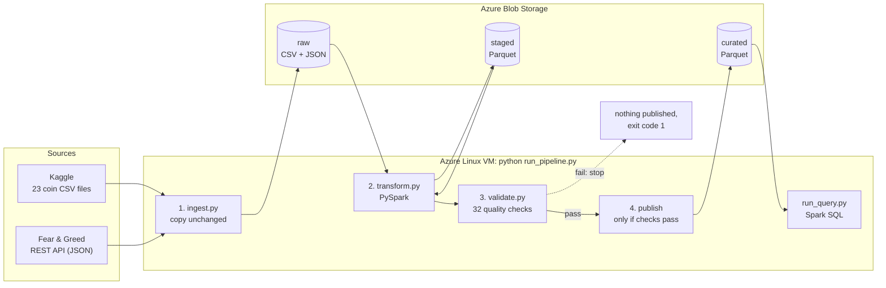

# Crypto Market Sentiment Pipeline

An end-to-end data engineering pipeline that combines **daily prices of 23 cryptocurrencies**
with the **Crypto Fear & Greed Index** to answer one question:

> **How do cryptocurrencies behave on the day after fearful vs. greedy market sentiment?**

The pipeline ingests both sources, moves the data through **raw → staged → curated** layers
with PySpark, checks its quality, and publishes a SQL-queryable data product to Azure Blob Storage.

*Semester project, Introduction to Data Engineering, ELTE, autumn 2026.*

---

## Contents

1. [Data sources](#1-data-sources)
2. [Architecture](#2-architecture)
3. [Technologies](#3-technologies)
4. [Project structure](#4-project-structure)
5. [Running locally](#5-running-locally)
6. [Running on Azure](#6-running-on-azure)
7. [Configuration and credentials](#7-configuration-and-credentials)
8. [Stopping and deleting Azure resources](#8-stopping-and-deleting-azure-resources)
9. [Results](#9-results)
10. [Data product documentation](DATA_PRODUCT.md)

---

## 1. Data sources

| | Crypto prices | Fear & Greed Index |
|---|---|---|
| **Provider** | Kaggle: [Cryptocurrency Historical Prices](https://www.kaggle.com/datasets/sudalairajkumar/cryptocurrencypricehistory) (sudalairajkumar) | [alternative.me](https://alternative.me/crypto/fear-and-greed-index/) public REST API |
| **Format** | 23 CSV files, one per coin | JSON over HTTPS |
| **Access** | Manual download (Kaggle account needed) | `GET https://api.alternative.me/fng/?limit=0&format=json`, no key needed |
| **Content** | Daily open, high, low, close, volume, market cap per coin | One value per day from 0 (extreme fear) to 100 (extreme greed), with a class label |
| **Period** | From 2013 (depends on the coin) to **2021-07-06** | From **2018-02-01** to today |
| **Rows** | 37,082 coin-days | ~3,190 days |
| **Update frequency** | Static snapshot (no longer updated) | Daily |

**How they are combined:** both sources have one row per **calendar day**, so they are joined on
`date`. Only the overlap of the two periods (**Feb 2018 – Jul 2021**) ends up in the curated data.

**Known limitations**
- The Kaggle dataset ends in July 2021, so the analysis does not cover later years.
- The Fear & Greed Index is a single, market-wide number (computed mostly from Bitcoin data);
  it is applied to every coin.
- The index has a few **missing days** (3 inside the overlap period, in 2018). On those days no
  coin can be matched; validation reports this as a warning.
- Some `Volume` / `Marketcap` values are `0` in the source, meaning "not recorded", not "no trading".
  They are converted to `null`.
- Two coins are **stablecoins** (USDT, USDC: pegged to $1). They are kept and flagged
  (`is_stablecoin`) as a control group that should *not* react to sentiment.

**Privacy:** both sources contain only aggregated market data, no personal information.

---

## 2. Architecture

The solution follows the **script-based approach** (Example A of the project description):
one Linux VM runs Python and PySpark (local mode), and Azure Blob Storage holds the three data layers.



**The three layers**

| Layer | Contents | Format | Purpose |
|---|---|---|---|
| **raw** | The 23 coin CSV files and the API's JSON response, **exactly as received** | CSV, JSON | Preserve the originals, so everything can be re-processed later |
| **staged** | `prices`, `fear_greed`: cleaned, typed, deduplicated, one row per coin-day / day. Rows that cannot be used go to `rejected/` **with a reason** | Parquet | A trustworthy, uniform version of each source |
| **curated** | `coin_daily_sentiment` (both sources joined, with returns and volatility) and `sentiment_summary` (aggregated answer to the question) | Parquet | The data product, queried with SQL |

**Raw path convention** (as in Lab 03): `<domain>/<YYYY>/<MM>/<DD>/source=<file|api>/<file>`,
e.g. `raw/prices/2026/10/26/source=file/coin_Bitcoin.csv`. The date is the *ingestion* date.

**Reliability by design**
- **Repeatable:** every step *replaces* its output (Parquet `overwrite` mode, the day's raw folder
  is cleared before writing, old Azure blobs are deleted before upload). Running the pipeline twice
  gives the same result, never duplicated rows.
- **Validate before publish:** curated tables are uploaded to Azure only after all ERROR-level checks pass.
- **Retries:** the API call is retried up to 3 times with growing waits (2 s, 4 s).
- **Visible outcome:** every step logs its start, result and duration, each run writes a log file to
  `logs/`, and the exit code reports the outcome (0 = success, 1 = data quality failed, 2 = technical error).

---

## 3. Technologies

| Component | Choice | Why |
|---|---|---|
| Storage | Azure Blob Storage (containers `raw`, `staged`, `curated`) | Cheap, simple, used in the labs |
| Processing | PySpark 4.0 in local mode on one VM | The data (~37k rows) fits on one machine; Spark gives a real distributed-processing API without a cluster |
| Pipeline execution | `run_pipeline.py` (plain Python) | Four steps in a fixed order do not need an orchestration service |
| Data format | Parquet | Columnar, compressed, keeps data types, readable by Spark SQL |
| SQL access | Spark SQL (`run_query.py`) | Same engine as the processing, no extra service |
| Ingestion | `requests` (API), `azure-storage-blob` (uploads) | Same libraries as in Lab 03 |

Infrastructure is created manually in the Azure Portal (section 6); no Infrastructure as Code is used.

---

## 4. Project structure

```
crypto-sentiment-pipeline/
├── run_pipeline.py        # runs everything: ingest → transform → validate → publish
├── ingest.py              # step 1: sources → raw
├── transform.py           # step 2: raw → staged → curated (PySpark)
├── validate.py            # step 3: data quality checks
├── storage.py             # saving to local folders and Azure Blob Storage
├── config.py              # all settings in one place
├── run_query.py           # run SQL against the curated tables
├── queries/               # example SQL queries
├── data/
│   ├── source/kaggle_crypto/   # put the Kaggle CSV files here (not in Git)
│   ├── sample/                 # saved API response + bad-data demo file
│   ├── raw/ staged/ curated/   # created by the pipeline (not in Git)
├── logs/                  # one log file per run (not in Git)
├── requirements.txt
├── README.md
└── DATA_PRODUCT.md        # documentation of the curated data product
```

---

## 5. Running locally

**Requirements:** Python 3.10+, Java **17** (or 21) for PySpark, a Kaggle account.

```bash
# 1. Java 17 (macOS with Homebrew; run_pipeline.py finds it automatically)
brew install openjdk@17

# 2. Python environment
python3 -m venv .venv
source .venv/bin/activate
pip install -r requirements.txt

# 3. Source data: download the Kaggle dataset and unzip it into
#    data/source/kaggle_crypto/   (subfolders and __MACOSX junk are handled)

# 4. Run the whole pipeline
python run_pipeline.py

# 5. Query the result
python run_query.py queries/sentiment_overview.sql
```

**Useful options**

| Command | What it does |
|---|---|
| `python run_pipeline.py --fng-file data/sample/fear_greed.json` | Uses a saved API response instead of calling the API (offline / demo) |
| `python run_pipeline.py --skip-ingest` | Re-processes the raw data already present |
| `python run_pipeline.py --kaggle-dir data/sample/bad_prices` | **Failure demo:** ingests a broken file; validation fails and nothing is published |
| `python run_query.py --sql "SELECT ..."` | Runs a SQL statement given on the command line |

The individual steps can also be run alone: `python ingest.py`, `python transform.py`, `python validate.py`.

---

## 6. Running on Azure

> Resources are created once, by hand, in the [Azure Portal](https://portal.azure.com).
> Use one of the regions allowed for your Azure for Students subscription (see Lab 01).

**One-time setup**

1. **Resource group:** create `rg-crypto-pipeline`. Everything below goes into it, so it can be deleted in one step.
2. **Storage account:** Standard, LRS (cheapest redundancy). Under *Data storage → Containers*,
   create three **private** containers: `raw`, `staged`, `curated`.
   Under *Security + networking → Access keys*, copy the **connection string**.
3. **Virtual machine:** Ubuntu Server 24.04 LTS, size `Standard_B2s` (2 vCPU, 4 GB RAM),
   SSH key authentication. Allow inbound SSH (port 22) from your IP only.
4. **Prepare the VM** (connect with `ssh azureuser@<vm-public-ip>`):

   ```bash
   sudo apt update
   sudo apt install -y openjdk-17-jre-headless python3-venv git unzip
   git clone https://github.com/SzonyiAn/crypto-sentiment-pipeline.git
   cd crypto-sentiment-pipeline
   python3 -m venv .venv
   source .venv/bin/activate
   pip install -r requirements.txt
   ```

5. **Copy the Kaggle files to the VM** (from your laptop):

   ```bash
   scp -r data/source/kaggle_crypto azureuser@<vm-public-ip>:~/crypto-sentiment-pipeline/data/source/
   ```

**Each run** (on the VM)

```bash
cd crypto-sentiment-pipeline
source .venv/bin/activate
export AZURE_STORAGE_CONNECTION_STRING="<connection string>"   # never commit this
python run_pipeline.py --target azure
python run_query.py queries/sentiment_overview.sql
```

With `--target azure`, every layer is written to the VM's disk as a working copy **and** uploaded to the
container of the same name. The results can be checked in the Portal under the storage account's containers.
`run_query.py` queries the curated Parquet files on the VM, which are the same files that were published.

---

## 7. Configuration and credentials

| Setting | Where | Default | Meaning |
|---|---|---|---|
| `AZURE_STORAGE_CONNECTION_STRING` | environment variable | (none) | **Secret.** Access to the storage account. Required only with `--target azure` |
| `PIPELINE_TARGET` | environment variable | `local` | Default for `--target` (`local` or `azure`) |
| `INGESTION_DATE` | environment variable | today | Overrides the date used in raw paths (`YYYY-MM-DD`), e.g. to re-run a past day |
| `STABLECOINS`, API URL, retry count | `config.py` | see file | Pipeline constants |

No secret is stored in the code or in Git (`.env` is in `.gitignore`).
To remove the secret from the shell after a session: `unset AZURE_STORAGE_CONNECTION_STRING`.

---

## 8. Stopping and deleting Azure resources

A running VM costs money every hour, even when idle; storage costs very little.

- **After each working session:** in the Portal, open the VM and click **Stop**. The status must show
  **Stopped (deallocated)**; only then does compute billing stop. (Shutting down from inside the VM
  with `sudo shutdown` is *not* enough.)
- **When the project is finished:** delete the whole resource group `rg-crypto-pipeline`
  (*Resource groups → rg-crypto-pipeline → Delete resource group*). This removes the VM, its disk,
  its IP address and the storage account in one step. With the Azure CLI:
  `az group delete --name rg-crypto-pipeline --yes`.

---

## 9. Results

Non-stablecoins, Feb 2018 – Jul 2021 (output of `queries/sentiment_overview.sql`):

| Sentiment | Days | Avg next-day return | Median next-day return | Next day up | Avg 7-day volatility |
|---|---|---|---|---|---|
| Extreme Fear | 285 | +0.21% | +0.22% | 52.3% | 6.27% |
| Fear | 445 | −0.11% | −0.18% | 47.6% | 4.49% |
| Neutral | 110 | −0.00% | −0.21% | 46.3% | 4.22% |
| Greed | 243 | +0.58% | +0.27% | 53.5% | 5.08% |
| Extreme Greed | 166 | +1.23% | +0.38% | 53.3% | 6.64% |

- **Volatility is U-shaped:** prices swing most at both emotional extremes and least at Neutral.
- **Greed tends to be followed by further gains** (momentum). The median confirms the pattern, but the
  average overstates it: for Extreme Greed it is about 3× the median, driven by a few very large days.
- **Extreme Fear shows a small rebound**, with average and median almost equal (a typical-day effect).
- **Direction stays close to a coin flip** (46–54% up days): the differences come from the *size* of moves.
- **The stablecoin control group** stays at about 0% return in every class, as expected.

These are descriptive statistics, not a trading strategy: many Extreme Greed days fall in the 2020–2021 bull
market, so greed and rising prices may both be effects of the same boom (correlation, not causation).
